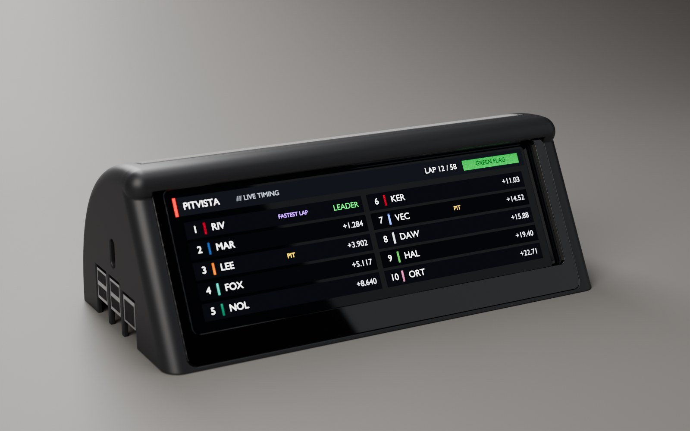
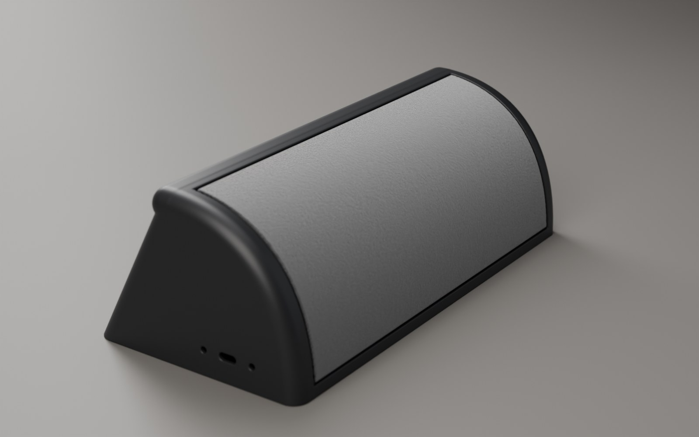

# functional-3dprint-design

**A Claude skill for designing functional 3D prints.** It works from your caliper measurements,
prints fit-tests first, builds parametric CadQuery models and exports print-ready 3MF files with
slicer and finishing guides.

Created by **Tamer Afifi**, from the workflow developed while building the PitVista desk
display enclosure.

> Real parts beat spec sheets, and a 20-minute fit test beats a 10-hour reprint.

| Front | Back |
|---|---|
|  |  |

*The PitVista desk display: renders made from the same geometry as its print files. Matte black
PLA shell, flush acrylic bezel, fabric-wrapped back, and a panel-mount USB-C power port.*

## What it does

When you ask Claude for a case, mount, bracket, clip or fixture, the skill walks it through:

1. **Intake.** What the part does, every interface where it meets real hardware, your printer,
   material and the finish you want.
2. **Measurements.** A numbered list with precise definitions (centre-to-centre vs outer edge,
   thickest point, and so on), three readings each, and photos for anything ambiguous.
3. **Parametric model.** A CadQuery (or build123d) script with `MEASUREMENTS`, `PARAMS` and
   derived dimensions kept separate, so you can tweak it later.
4. **Fit tests first.** Small slices of the real model around each interface, plus a clearance
   gauge. Print them in minutes, report back, adjust.
5. **Deliverables.** Print-ready **3MF** (and STL) per part in print orientation, a print sheet,
   assembly steps and an optional finishing guide.
6. **Lessons.** Problems found after printing get fixed and written down.

## Repository layout

```
functional-3dprint-design/
├── SKILL.md                     # the skill itself
├── references/
│   ├── measurement.md           # how to ask for and record measurements
│   ├── design-rules.md          # clearances, walls, snap-fits, snap-in mounts, inserts
│   ├── print-settings.md        # material, orientation, slicer profiles
│   ├── finishing.md             # sand, prime, paint, clear coat, fabric wrap, bezel
│   └── lessons-learned.md       # real failures and how to avoid them
├── helpers/
│   ├── export_3mf.py            # pure-Python 3MF/STL writer + CadQuery/build123d adapters
│   ├── fit_test.py              # slice tests and clearance gauge
│   └── validate.py              # validity, bed-fit and closed-mesh checks
└── examples/
    ├── display-enclosure/       # screen + Raspberry Pi case, hidden ports, screwless USB-C
    └── snap-cable-clip/         # small snap-fit part
```

## Install

**Claude Code:** copy the skill folder into your skills directory:

```bash
git clone https://github.com/tamer-afifi/3d-print-design-skill
cp -r 3d-print-design-skill/functional-3dprint-design ~/.claude/skills/
```

**Claude apps:** zip the `functional-3dprint-design` folder and upload it as a custom skill in
Claude's settings.

To run the models yourself:

```bash
pip install cadquery        # or: pip install build123d
python functional-3dprint-design/examples/display-enclosure/enclosure.py
```

## Try it

> "I need a case for a 5-inch HDMI screen with a Pi Zero on the back. Power comes in through
> USB-C on the bottom, no visible screws, and I'll paint it."

> "Design a wall bracket for my router. It's 180 × 120 × 30 mm and the wall has two screws
> 100 mm apart."

## Default settings from the PitVista build

- PLA, printed upright, **0.12 mm** layers, **tree supports (build plate only)**, brim,
  seam at the back
- Screwless snap-in mounts: pegs + slide-in retainer
- Finish: sand 220/320 → filler primer → wet-sand 400/600 → colour → satin clear; mask fit
  surfaces; optional fabric wrap with Super 77; acrylic bezel last

## Status

The 3MF/STL writer and mesh checks are tested. The example models are written against the
CadQuery 2.x API. If you hit an API difference on your CadQuery version, please open an issue.

## License

[MIT](LICENSE) © Tamer Afifi
