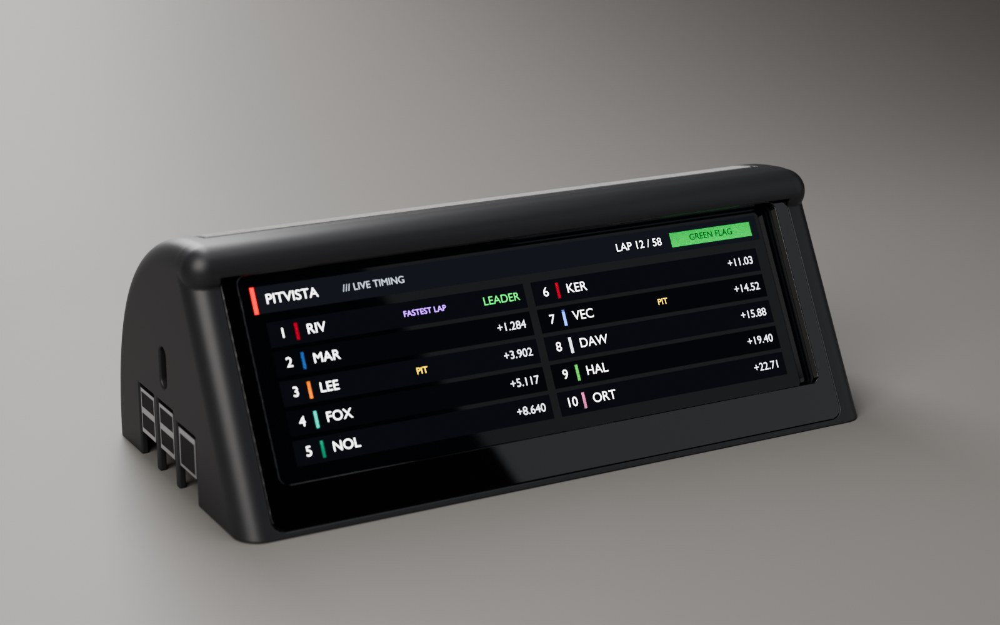

# Example: display + Raspberry Pi enclosure

Based on the **PitVista** desk display: a touchscreen with a Raspberry Pi mounted on its back.
All of the Pi's ports are hidden inside, and a single panel-mount USB-C extension brings power in.



The real PitVista shell is a curved desk wedge with a fabric-wrapped back. This example keeps
the same techniques in a simpler box shape, so you can see what each part of the script does.

## What it shows

- Measurements and parameters kept separate, with every derived dimension computed in code
- **Clip posts** sized from the *measured* screen thickness (lesson #3)
- **Screwless USB-C panel mount:** pegs through the ear holes + a slide-in retainer
  (lesson #1: ear spacing converted from an outer-edge measurement)
- Corner bosses for **heat-set inserts**, with 45° cones so they print without support
- **Fit tests** generated from the real model: a USB-C slice, a clip-post slice, and a
  clearance gauge

## Run

```bash
pip install cadquery
python enclosure.py
```

Output in `out/`:

| File | Print |
|---|---|
| `fit_tests.3mf` | **First.** USB-C slice + retainer, clip slice, clearance gauge + key. Press *Arrange* in the slicer. |
| `shell.3mf` | Front face down. Cosmetic profile (0.12 mm, tree supports build-plate only, brim, seam at back) |
| `back_cover.3mf` | Flat, outside face down |
| `retainer.3mf` | Flat |

## Fit-test checklist

1. **Gauge:** which hole lets the key's peg slide with light pressure? Which slot lets the tab
   slide? Put those clearances into `c_peg` and `c_slide`.
2. **USB-C slice:** the socket goes through the cut-out, the ear holes drop onto the pegs, and
   the retainer slides down the grooves and holds the flange without rattling.
3. **Clip slice:** a scrap of the screen's edge (or a stack of card cut to the measured
   thickness) snaps under the hook and stays put.

## Assembly

1. Melt the four heat-set inserts into the corner bosses.
2. Do the finishing work now if you want it (`references/finishing.md`). Mask the clip posts,
   the USB-C pocket and the grooves first.
3. Drop the screen in from the back until the clip posts snap over it.
4. Place the USB-C flange on the pegs and slide the retainer down the grooves.
5. Connect the Pi, then screw on the back cover. The cover also stops the retainer lifting.

All dimensions in `MEASUREMENTS` are **example values**. Measure your own parts first.
